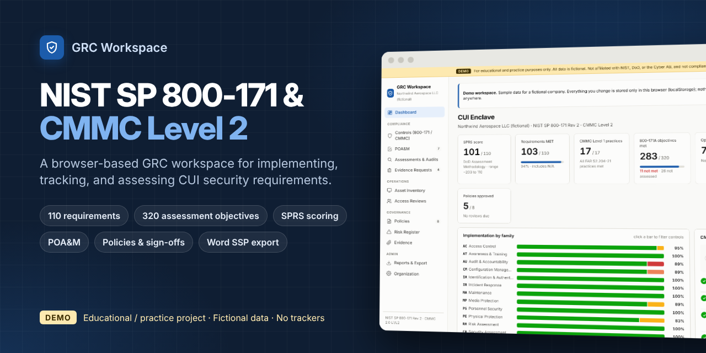
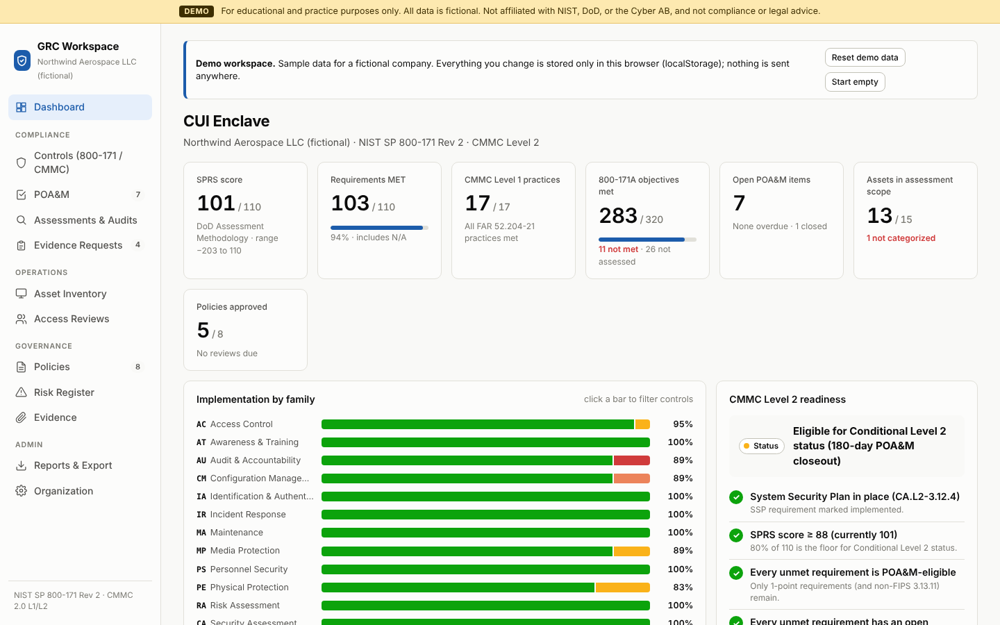
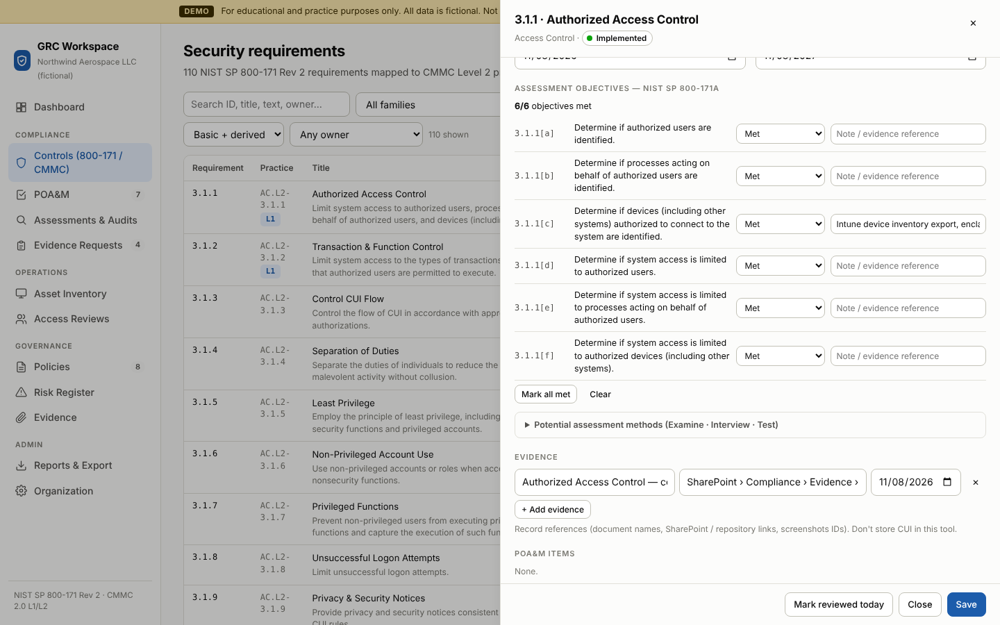
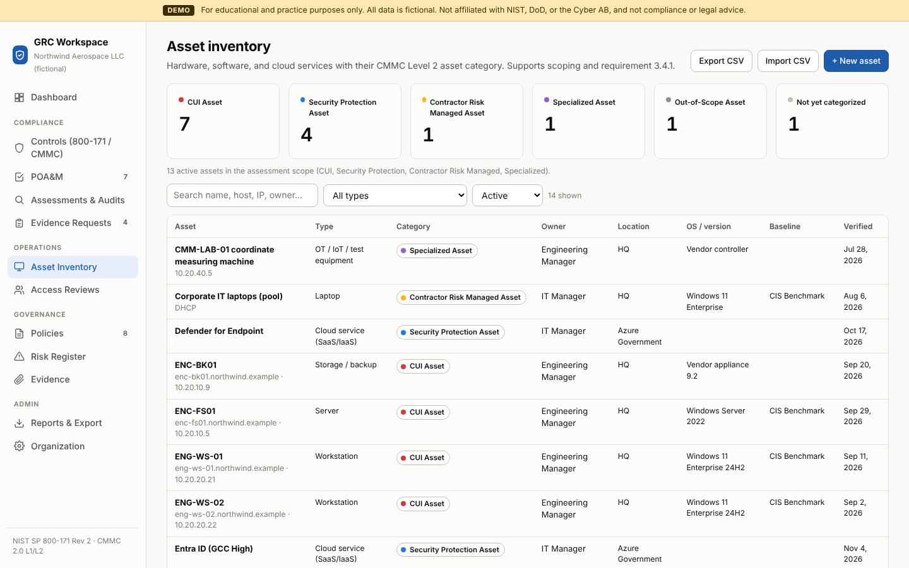
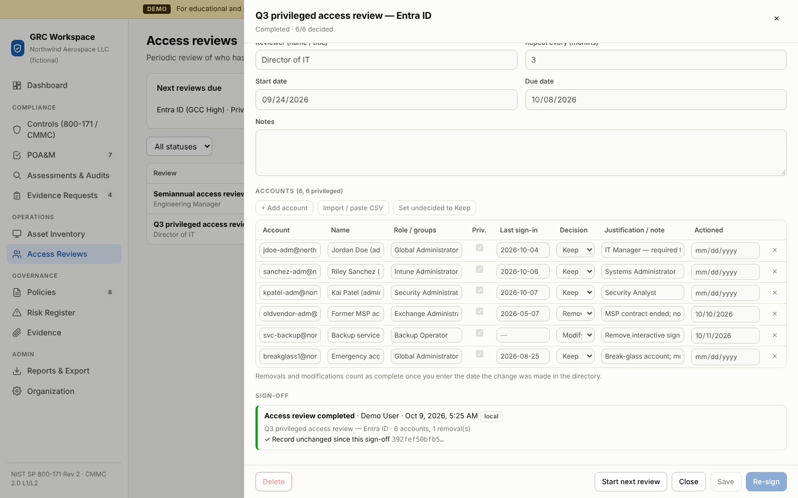
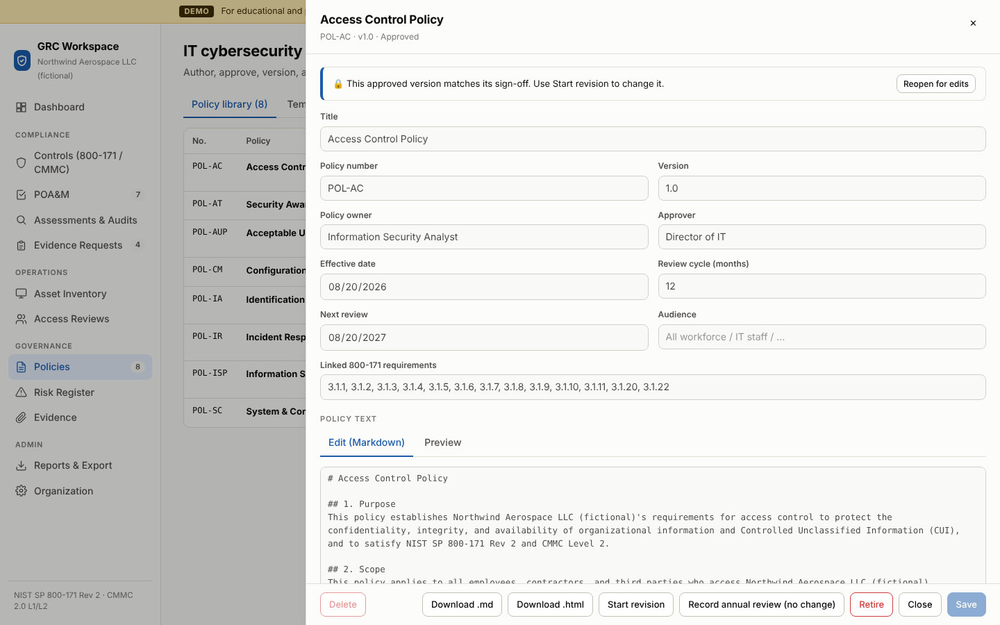
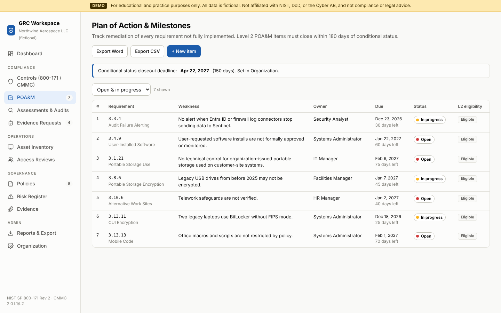

# GRC Workspace — NIST SP 800-171 / CMMC Level 2 (Demo)



> **DEMO — for educational and practice purposes only.** All data is fictional. This project is not affiliated with NIST, DoD, or the Cyber AB, and it is not compliance or legal advice. A notice saying so appears at the top of every page, and exported Word and HTML documents are labeled the same way.

A browser-based governance, risk, and compliance (GRC) workspace for implementing, maintaining, and assessing the security requirements that protect Controlled Unclassified Information (CUI) under **NIST SP 800-171 Rev 2** and **CMMC Level 2**.

This is a practice project. It runs entirely in your browser with sample data for a **fictional** company, Northwind Aerospace LLC, so you can click through a realistic program: an SPRS score of 101, Conditional Level 2 eligibility, open POA&M items, signed policies, and a completed access review.

**▶ Live demo:** [a-espindola.github.io/grc-800-171-demo](https://a-espindola.github.io/grc-800-171-demo/)


*Dashboard: SPRS score, 800-171A objectives, CMMC Level 2 readiness, and implementation by family.*

---

## Privacy: no trackers, no network calls

- **No analytics, cookies, web fonts, or CDNs.** Every file the app loads is in this repository.
- **A strict Content-Security-Policy** in `index.html` (`connect-src 'none'`, `default-src 'none'`) blocks the page from contacting any server, even if code tried to.
- **Data stays on your device.** Anything you enter is saved only in your browser's `localStorage`. Exports (Word, CSV, JSON) are generated in the browser and downloaded directly.
- **`no-referrer`** policy, and outbound links open with `rel="noopener noreferrer"`.

You can verify this yourself: open DevTools → **Network**, reload, and click around. The only requests are this repo's own `index.html`, `css/`, `js/`, and `lib/` files.

> Don't enter real CUI, passwords, or other sensitive data into a public demo. This app records *references* to where evidence lives, not the evidence itself.

---

## Features

### Compliance
- **110 security requirements**, each with its CMMC practice ID (e.g., `AC.L2-3.1.1`), NIST's basic/derived classification, the official NIST discussion text, and the 17 CMMC Level 1 practices flagged.
- **320 assessment objectives from NIST SP 800-171A** in a checklist under each control (Met / Not met / N/A, with notes). The app warns if a requirement is marked Implemented while any objective is Not met, because that is how it would be scored at assessment.
- **SPRS scoring** using the DoD Assessment Methodology (−203 to 110), including partial-credit rules for 3.5.3 (MFA) and 3.13.11 (FIPS-validated crypto).
- **CMMC Level 2 readiness check** per 32 CFR 170.21: score ≥ 88, an SSP in place, only POA&M-eligible gaps, and a POA&M item for each.
- **POA&M** with eligibility flags, milestones, and a 180-day conditional-status countdown.
- **Assessments & audits** with point-in-time snapshots, findings, and an SPRS trend chart.
- **Evidence requests** for tracking what an assessor or prime contractor asks for. Each request has an owner, a due date, and a status, and you can add many at once by pasting a list.

### Operations
- **Asset inventory** with CMMC Level 2 scoping categories (CUI, Security Protection, Contractor Risk Managed, Specialized, Out-of-Scope), configuration baselines, FIPS crypto tracking, and CSV import.
- **Access reviews:** import an account export, record Keep / Modify / Remove decisions with justification, track when removals were actually actioned, then complete and sign off.

### Governance
- **20 IT cybersecurity policy templates** mapped to 800-171 requirements, with a Draft → In review → Approved workflow, versioning, review cycles, and a coverage view.
- **Named sign-offs** for policy approvals, access reviews, and assessment results. Each sign-off stores a SHA-256 fingerprint of the record. Signed records lock, and the app shows when a record changed after signing.
- **Risk register** with a 5×5 heat map.

### Reports
- **System Security Plan (.docx)** and **POA&M (.docx)**: editable Word documents generated in the browser.
- CSV exports: controls, 800-171A objectives worksheet, POA&M, assets, access reviews, evidence requests, risk register, and sign-off register. Plus a full JSON backup and restore.

| | |
|---|---|
|  |  |
| *800-171A objectives checklist on a control* | *Asset inventory with CMMC scoping categories* |
|  |  |
| *Completed, signed access review (locked)* | *Approved policy locked to its sign-off* |
|  | |
| *POA&M with Level 2 eligibility* | |

---

## Run it

No build step and no dependencies to install.

- **Locally:** download or clone the repo and open `index.html` in a modern browser (Chrome, Edge, Firefox, Safari).
- **Reset:** the Dashboard and Organization pages have **Reset demo data** and **Start empty** buttons.

### Publish on GitHub Pages
1. Push this folder to a new GitHub repository (e.g., `grc-800-171-demo`).
2. In the repository, go to **Settings → Pages**.
3. Under **Build and deployment**, choose **Deploy from a branch**, select `main` and `/ (root)`, and save.
4. After a minute the site is live at `https://a-espindola.github.io/grc-800-171-demo/`. If you fork or rename the repository, update the link at the top of this README.
5. *(Optional)* Set the thumbnail shown when the repo is shared: **Settings → General → Social preview → Edit → Upload an image**, and choose `docs/social-preview.png`.

---

## Project structure

```
index.html                 App shell and Content-Security-Policy
css/styles.css             Styles (light and dark mode)
js/catalog.js              110 requirements, CMMC IDs, SPRS weights, POA&M rules, policy templates
js/nist-800-171-rev2.js    NIST discussion text and basic/derived types (SP 800-171 Rev 2)
js/nist-800-171a.js        320 assessment objectives and examine/interview/test methods (SP 800-171A)
js/app.js                  Core views: dashboard, controls, POA&M, assessments, policies, risks, reports
js/modules.js              Assets, access reviews, evidence requests, sign-offs, Word export
js/demo-data.js            Fictional sample dataset (dates are relative to today)
js/main.js                 Startup
lib/docx.iife.js           docx v9.8.1 (MIT), used for Word export
```

Plain JavaScript, HTML, and CSS with no frameworks.

---

## Sources and framework versions

- **NIST SP 800-171 Rev 2** and **NIST SP 800-171A (June 2018)**: requirement text, discussion, and assessment objectives, taken from NIST's CPRT datasets. NIST publications are U.S. Government works and are not subject to copyright in the United States.
- **CMMC Program rule, 32 CFR Part 170**: Level 2 POA&M eligibility and the conditional-status threshold.
- **DoD Assessment Methodology for NIST SP 800-171**: SPRS point values.
- **CMMC Level 2 Scoping Guidance**: asset categories.

**Why Rev 2?** NIST published SP 800-171 Rev 3 in May 2024, but as of November 2026 DoD contracts (DFARS 252.204-7012) and CMMC Level 2 still assess against Rev 2. DoD has said it intends to move to Rev 3.

---

## How this was built

This project was built with AI assistance. I defined the requirements and features, supplied the NIST source datasets, made the design decisions, and reviewed and tested the results. Claude, an AI assistant made by Anthropic, helped write the code and documentation. Framework content such as requirement text, assessment objectives, and scoring rules comes from the published NIST and DoD sources listed above, not from the AI.

## Limitations

- This is a **portfolio and practice project for educational purposes**. It is not affiliated with or endorsed by NIST, the DoD, or the Cyber AB, and it is not legal or compliance advice.
- All sample data is **fictional**. Domains use the reserved `.example` TLD, and IP addresses are private ranges.
- In this demo, sign-offs use a locally entered name and are **not tied to a verified identity**. The fingerprints show whether a record changed after signing, but they aren't a cryptographic signature.
- Policy templates are starting points. Organization-defined values in `[brackets]` need tailoring before use.

## License

Code: [MIT](LICENSE) © 2026 Andres Espindola. Third-party components: see [THIRD_PARTY_NOTICES.md](THIRD_PARTY_NOTICES.md).
